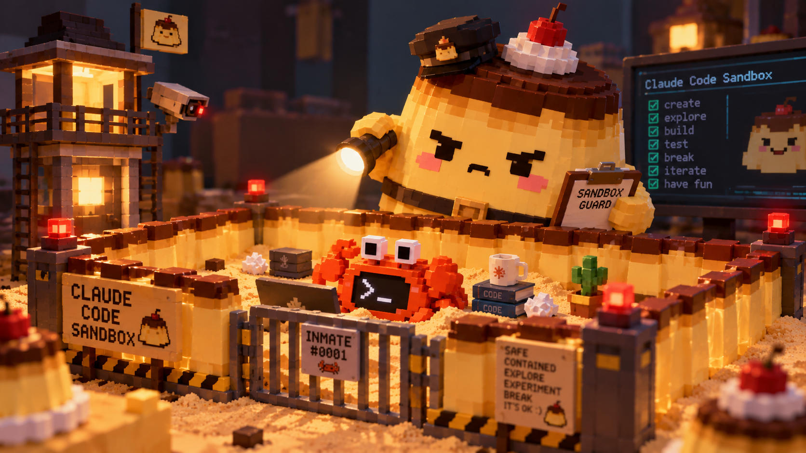

# puddibox: WSLC setup for Mr. Claude Crab

<p align="center">
  
</p>

puddibox runs [Claude Code](https://code.claude.com) for a Windows project folder inside an
isolated WSL container (`wslc.exe`). VS Code stays on Windows and sees the same files.
You start a session with `Ctrl+Alt+C`. The puddibox VS Code extension shows the running sandboxes and
your subscription usage in the status bar.

> puddibox is an unofficial community project. It is not affiliated with or endorsed by Anthropic.

## Contents

- [How it works](#how-it-works)
- [What is isolated](#what-is-isolated)
- [Requirements](#requirements)
- [Installation](#installation)
- [Login: token mode and /login](#login-token-mode-and-login)
- [VS Code extension](#vs-code-extension)
- [Daily use](#daily-use)
- [Post-session review](#post-session-review)
- [Limitations: read this first](#limitations-read-this-first)
- [Domain allowlist](#domain-allowlist)
- [Python and uv](#python-and-uv)
- [Line endings](#line-endings)
- [Troubleshooting](#troubleshooting)
- [Status](#status)
- [Credits and license](#credits-and-license)

## How it works

```
 Windows                                   wslc session (VM)
 ───────                                   ─────────────────────────────────────────────────
 VS Code ──ext/task──> claude-box.ps1 ───> internal network (no route out)
                                             ┌─────────────────────┐      ┌──────────────┐
 D:\proj\foo  <── bind mount ──────────────> │ agent container     │ ───> │ squid proxy  │ ──> allowlisted
                                             │ /workspace          │ 3128 │ CONNECT :443 │     HTTPS only
                                             │ user "claude", no   │      │ allowlist    │
                                             │ capabilities        │      └──────────────┘
                                             │ placeholder token   │      ┌──────────────┐
                                             │                     │ ───> │ api-proxy    │ ──> api.anthropic.com
                                             └─────────────────────┘ 8080 │ real token   │     /v1/messages only
                                                                          └──────────────┘
 Windows Credential Manager ──token (token mode)──────────────────────────────────┘
```

1. `claude-box.ps1` creates an internal network for the project. This network has no route out.
2. The launcher starts a Squid proxy. The proxy is on the internal network and on the default network.
   It allows HTTPS (CONNECT to port 443) only to domains on the allowlist.
3. Token mode only: the launcher starts `api-proxy` with the subscription token from Windows
   Credential Manager. The proxy is the only way to the Claude API (see
   [Login](#login-token-mode-and-login)).
4. The launcher starts the agent container on the internal network only.
5. The agent container verifies the sandbox as `root` before it starts. If one check fails,
   the container does not start:
   - `.venv` is a separate volume,
   - `.git`, `.vscode` and `.claude` are read-only,
   - there is no direct internet access (by name, by IP, on port 80, over IPv6),
   - there is no external DNS,
   - the host, the gateway, the cloud metadata address and `host.wslc.internal` are not reachable,
   - the proxy blocks non-allowlisted domains and bare IP addresses,
   - `/login` mode: the proxy allows `api.anthropic.com`;
   - token mode: `api-proxy` answers, and `api.anthropic.com` is blocked for the agent.
6. The container drops to user `claude` with no capabilities and `no_new_privs`, then starts Claude Code.
7. When the session ends, the launcher removes the proxies and the network and shows a review of
   files that Windows tools execute or trust.

## What is isolated

| Item | In the container | Why |
| --- | --- | --- |
| Project folder | `/workspace`, read-write | Claude works on your files. You see the diffs in VS Code. |
| `.venv` | separate volume `claude-venv-<project>` over the Windows one | The agent gets a Linux venv and cannot replace the `python.exe` that VS Code runs. |
| `.git` | read-only; the launcher refuses to start without a `.git` folder or with a `.git` file | Hooks and `.git/config` (for example `core.fsmonitor`) run on Windows. |
| `.vscode` | read-only | `tasks.json` and `settings.json` can run commands on Windows. |
| `.claude` | read-only | Hooks in `.claude/settings.json` run if you start Claude Code for this project on Windows. |
| Network | `--internal` network, no external DNS, only the allowlisting proxy (HTTPS, no bare IPs) | Limits code exfiltration through prompt injection. |
| Subscription token (token mode) | outside the agent: Windows Credential Manager and the `api-proxy` container; the agent has a placeholder | A prompt injection cannot steal the token. |
| Claude login and settings | volume `claude-config-<project>` | Projects do not share hooks, commands or conversation history. |
| uv cache | volume `claude-uv-cache-<project>` | One project cannot poison packages for another. |
| Privileges | user `claude`, no capabilities, `no_new_privs` | |

## Requirements

- Windows 11 with WSL that includes WSL containers (`wsl --update`, then `wslc version`).
- Windows Terminal (`wt.exe`). The VS Code tasks open sessions in it.
- VS Code (optional, for the extension or the tasks and shortcuts).
- Git for Windows 2.38 or later (for `safe.bareRepository`).
- Node.js 20 or later (optional, only to build the VS Code extension).
- For token mode: a Claude Pro, Max, Team or Enterprise subscription.

## Installation

Do these steps one time.

1. Clone the repository to `%USERPROFILE%\puddibox`:
   ```powershell
   git clone https://github.com/puddiduddi/puddibox $env:USERPROFILE\puddibox
   ```
   If you use a different folder, change the `-File` paths in `vscode\tasks.json` in step 5.

2. Configure wslc. Run this in a normal console, not as administrator:
   ```powershell
   wslc settings
   ```
   The command creates `%LOCALAPPDATA%\wslc\settings.yaml` and opens it. Set:
   ```yaml
   session:
     hostLoopback: none          # containers do not get the host.wslc.internal name for the Windows host
     # storagePath: D:\wslc-data # optional: keep images and volumes on another drive
     # maxStorageSize: 100GB     # optional: cap the session disk (default 1TB)
   ```
   Then stop the session so that wslc reads the new settings:
   ```powershell
   wslc system session terminate
   ```
   See [WSL container settings](https://learn.microsoft.com/en-us/windows/wsl/wsl-container-settings).

   wslc uses one session for a normal console and a different session for an elevated console.
   Each session has its own images and volumes. Always use a normal console for puddibox.

3. Build the images:
   ```powershell
   cd $env:USERPROFILE\puddibox
   .\Build-ClaudeSandbox.ps1
   ```
   This builds `claude-egress-proxy:local` (Alpine + Squid), `claude-api-proxy:local`
   (Alpine + Python) and `claude-sandbox:local` (Debian + git + uv + Python 3.12/3.13 + Claude Code).
   Run it again to update Claude Code.

4. Configure Git and Windows on the host:
   ```powershell
   git config --global safe.bareRepository explicit
   setx NoDefaultCurrentDirectoryInExePath 1
   ```
   - `safe.bareRepository explicit`: Git ignores a bare repository that the agent plants in a
     subfolder (its `config` can run commands through `core.fsmonitor`). Normal repositories work as before.
   - `NoDefaultCurrentDirectoryInExePath`: `cmd.exe` does not run programs from the current folder,
     so a planted `git.bat` cannot replace the real `git`. Restart VS Code and terminals after this command.

5. Configure VS Code:
   - Command Palette > **Preferences: Open User Settings (JSON)**: add the entries from `vscode\settings.json`.
   - Install the puddibox extension (recommended, see [VS Code extension](#vs-code-extension)). It
     starts sessions with `Ctrl+Alt+C` and `Ctrl+Alt+Shift+C`.
   - Without the extension: Command Palette > **Tasks: Open User Tasks**: add the tasks from
     `vscode\tasks.json`, and Command Palette > **Preferences: Open Keyboard Shortcuts (JSON)**: add the
     entries from `vscode\keybindings.json`. Do not add these shortcuts if you use the extension.

   Use user tasks, not `.vscode/tasks.json` in a project. The agent cannot edit user tasks.

   `vscode\settings.json` sets `"git.autoRepositoryDetection": false`. VS Code then does not open a
   repository that the agent creates in a subfolder. Side effect: when `.git` is created after the
   folder is open (for example `git init`), run **Developer: Reload Window** or **Git: Open Repository**.

6. Test the sandbox in a test project:
   ```powershell
   mkdir D:\tmp\sandbox-test; cd D:\tmp\sandbox-test; git init
   & $env:USERPROFILE\puddibox\claude-box.ps1 -Shell
   ```
   A correct start shows:
   ```
   egress: proxy-only egress verified
   sandbox: checks passed, starting as user claude
   ```
   Then, in the sandbox shell:
   ```bash
   touch .git/x                                  # must fail: Read-only file system
   curl -s --max-time 5 https://example.com      # must fail
   getent hosts example.com                      # must print nothing
   id                                            # must show uid=1000(claude)
   ```
   In `/login` mode, `curl -sI https://api.anthropic.com | head -1` must show an HTTP status line.
   In token mode it must fail with `CONNECT tunnel failed, response 403`.

7. Recommended: set up token mode (next section).

## Login: token mode and /login

The launcher uses token mode when a token is stored in Windows Credential Manager. Otherwise it uses `/login`.

### Token mode (recommended)

1. On Windows, run `claude setup-token`. It opens a browser and prints a token `sk-ant-oat...`.
   The token is valid for about one year.
2. Store the token:
   ```powershell
   & $env:USERPROFILE\puddibox\claude-box.ps1 -SetToken
   ```
   The launcher stores it in Windows Credential Manager as `puddibox:claude-oauth-token`. Windows
   encrypts this entry for your account (DPAPI). `gh`, `glab` and Git Credential Manager use the same store.
3. Clear the clipboard and close the terminal with the token.

At each start the launcher reads the token and gives it only to the `api-proxy` container, by
variable name, never on a command line. The agent gets `ANTHROPIC_BASE_URL=http://claude-api-<project>:8080`
and a placeholder token. `api-proxy`:

- always overwrites the authentication headers with the real token, so a request with an attacker's
  API key cannot reach the attacker's account;
- forwards only `/v1/messages`, so the agent cannot call other endpoints with your token (for example
  to create an API key);
- is the only way to `api.anthropic.com`. The egress proxy blocks that domain for the agent, and the
  container checks this at startup.

Limits of token mode:

- The `setup-token` token can only send model requests. Remote Control and claude.ai connectors do not work.
- The agent can still use your subscription limits.
- Windows Credential Manager protects the token from other accounts and from a stolen disk. It does not
  protect it from programs that run as your Windows user.

Other commands:
```powershell
& $env:USERPROFILE\puddibox\claude-box.ps1 -RemoveToken   # delete the token, back to /login per project
& $env:USERPROFILE\puddibox\claude-box.ps1 -NoToken       # this session only: ignore the token, use /login
```
If the token may have leaked, also revoke it on claude.ai.

A project that used `/login` before still has `~/.claude/.credentials.json` in its config volume. Token
mode does not use that file, but the agent can read it. Remove it once: start `-Shell`, then
`rm ~/.claude/.credentials.json`.

### /login mode

Without a stored token, the first session in each project shows a login link. Open it in a browser on
Windows. If the redirect does not return to the terminal, paste the code at `Paste code here`. The
login is per project. In this mode the token is in the config volume, and `api.anthropic.com` is open
for the agent (see [Exfiltration through allowed domains](#exfiltration-through-allowed-domains)).

## VS Code extension

The `vscext` folder contains the puddibox extension. Build and install it:

```powershell
cd $env:USERPROFILE\puddibox\vscext
npm install
npm run compile
npm run package
code --install-extension (Get-ChildItem puddibox-*.vsix | Select-Object -Last 1).FullName
```

Then run **Developer: Reload Window**. If the kit is not in `%USERPROFILE%\puddibox`, set
`puddibox.launcherPath` in your user settings.

What the extension gives you:

- **Status bar, left**: the session of the current project (`sandbox`, `sandbox: bypass`, `sandbox: shell`),
  a mark for a pending review, and `+N` for sandboxes of other projects. A click opens a menu.
- **Status bar, right**: `$(vm-active) N` running sandboxes, then the 5-hour and 7-day subscription usage.
- **Sidebar panel**: sessions with **Stop** and **Kill now**, project volumes, token, images (rebuild),
  extra egress domains for the project, and the last review with diffs.
- **Commands**: `Ctrl+Alt+C` (Claude), `Ctrl+Alt+Shift+C` (bypass, after a confirmation), and the
  `puddibox` category in the Command Palette.

Usage comes from the `api-proxy` log in token mode: the proxy writes the values of the
`anthropic-ratelimit-unified-*` response headers. Without fresh sandbox data, a click on the usage item
reads usage one time with the Windows Claude Code login. A `$(account)` mark shows that source. See
[vscext/README.md](vscext/README.md) for all details.

The extension reads no settings or files from the workspace, never touches the `setup-token` token,
and warns when the launcher is inside a project folder with a running sandbox.

## Daily use

| Shortcut / command | What it does |
| --- | --- |
| `Ctrl+Alt+C` | Claude Code in the sandbox, with permission prompts |
| `Ctrl+Alt+Shift+C` | Claude Code with `--dangerously-skip-permissions` |
| **Open sandbox shell** (extension) or task **Sandbox shell** | `bash` in the same sandbox, for example `uv sync` or `uv run pytest` |

A session opens in a new Windows Terminal window. At the end the window waits for Enter only when
the review has findings, the review failed, or the exit code is unusual. Otherwise it closes after
5 seconds. With the tasks: for a new tab instead of a new window, change `"new"` to `"0"`. For the VS
Code integrated terminal, set `"command": "powershell.exe"`, remove the arguments before `-NoProfile`
and the `-Pause` argument, and set `"reveal": "always"`. With the extension, set `puddibox.terminal`.

End a session with `/exit` (Claude), `exit` (shell), or **Stop** in the extension. Do not close the
window or the VS Code terminal while the session runs: the launcher then cannot clean up or show the
review. If this happens, the next start for the same project cleans up and shows the review.

### Launcher options

```powershell
claude-box.ps1 -Path D:\proj\foo           # project folder (default: current folder)
claude-box.ps1 -Shell                      # bash instead of Claude Code
claude-box.ps1 -Bypass                     # --dangerously-skip-permissions
claude-box.ps1 -Continue                   # continue the last conversation
claude-box.ps1 -Resume                     # pick a conversation to resume
claude-box.ps1 -ClaudeArgs '--model opus --append-system-prompt "be brief"'
claude-box.ps1 -Pause                      # in a separate window: wait for Enter if there is something to read
claude-box.ps1 -Status [-Json]             # project id, container and volume names, token, review; changes nothing
claude-box.ps1 -SetToken                   # store a "claude setup-token" token (token mode)
claude-box.ps1 -RemoveToken                # delete the stored token
claude-box.ps1 -NoToken                    # this session only: /login mode
```

These options make the isolation weaker. Use them only after a conscious decision:

| Option | What changes | Risk |
| --- | --- | --- |
| `-GitWritable` | `.git` is writable; the launcher also starts without `.git` or with a `.git` file | The agent can add `core.fsmonitor`, hooks or `core.hooksPath` to `.git/config`. Windows Git runs them. |
| `-ClaudeDirWritable` | the project `.claude/` is writable | The agent can add hooks that run when you start Claude Code for this project on Windows. |
| `-ConfigVolume claude-config` | one login and shared settings for all projects | One project can add hooks for all projects and read their conversation history. |
| `-AllowDomain <domain>` | an extra domain on the allowlist | Each domain is a new exfiltration channel. |

## Post-session review

The sandbox cannot stop the agent from writing files in `/workspace`. Some of these files are
executed or trusted by Windows tools. The launcher records them before the session and shows every
difference after it (`+ added`, `~ changed`, `- removed`):

- every `.git` (also nested), `.vscode`, `.claude`, `.devcontainer`, `.github`, `*.code-workspace`, `.env*`;
- `conftest.py`, `setup.py`, `noxfile.py`, `sitecustomize.py`, `pyproject.toml`, `setup.cfg`, `uv.lock`,
  `requirements*.txt`, `tox.ini`, `mypy.ini`, `pylintrc`, `.pre-commit-config.yaml`, `Makefile`,
  `package.json`, `CLAUDE.md`;
- `.pth`, `.pyc`, `.bat`, `.cmd`, `.exe`, `.dll`, `.ps1`, `.lnk` and other executable files;
- every link (symlink, junction), because on Windows it can point outside the project;
- in the root `.git`: `config`, `hooks/`, `info/`.

The launcher keeps the last review in `%USERPROFILE%\puddibox\state\<project>.last-review.json`. The
extension shows it in the **Last review** section of the panel. The file
`state\<project>.review.json` exists while a session runs; if it is still there after the session, the
review did not run, and the next start shows it.

The container sets `PYTHONDONTWRITEBYTECODE=1`, so a new `.pyc` file after a session is suspicious.
Windows Python runs a `.pyc` whose header matches the source, even if the bytecode is different.

The review is the second line of defense. VS Code reacts to files **during** the session, so the
VS Code and host settings from the installation are the first line.

## Limitations: read this first

### Code that runs on Windows

The sandbox protects against what the agent does **itself**. It does not protect against code that
the agent writes and a Windows tool runs later. Some tools do this without your action:

- Test discovery in the VS Code Python extension imports `conftest.py` and test modules when the
  project opens. `vscode\settings.json` only turns off discovery on save. Turn off pytest for
  sandbox projects for full protection.
- The mypy extension loads `plugins` from `pyproject.toml`. The pylint extension runs `init-hook`
  and `load-plugins`. Turn these extensions off for sandbox projects, or accept the risk.
- The Python extension loads `.env` into debug and test runs (for example `PYTHONSTARTUP`, `PYTHONPATH`).
- `pytest` or `uv sync` on Windows runs the agent's `conftest.py`, tests and build configuration
  with your permissions.
- CI runs changes in `.github/workflows/` after you push, with the repository secrets.

So: test agent code in the sandbox first, read the post-session review, and run code on Windows
only after you read the diff.

### Exfiltration through allowed domains

The allowlist limits exfiltration. It does not stop it. The proxy does not inspect TLS:

- `/login` mode: `api.anthropic.com` accepts requests with an attacker's API key. A prompt injection
  can send code, or the login token from `~/.claude/.credentials.json`, that way. Token mode closes
  this channel.
- `.claude.ai` and `.claude.com` stay open in both modes.
- Each domain that you add with `-AllowDomain` is a new channel. For example, `github.com` allows a
  push or a gist with an attacker's token.

### wslc isolation

The agent container starts as `root` for the checks and then drops all privileges. The container
boundary itself is the wslc session VM and container runtime. puddibox does not add more isolation
than wslc gives.

## Domain allowlist

Default: `api.anthropic.com`, `.claude.ai`, `.claude.com`, `pypi.org`, `files.pythonhosted.org`.

In token mode the list has no `api.anthropic.com`. The agent reaches the Claude API only through `api-proxy`.

There is no blocklist. The proxy blocks every domain that is not on the allowlist, every port
other than 443, plain HTTP and bare IP addresses.

- Permanent change: edit `$DefaultDomains` in `claude-box.ps1`. No rebuild is necessary.
- One run: `claude-box.ps1 -AllowDomain example.org,.example.net`.
- `example.org` allows only that host. `.example.org` allows the domain and all subdomains.
  Do not list both forms of the same domain: Squid then does not start.
- Do not add `example.com`. The startup check uses it as the blocked test domain.

To find a blocked domain, read the proxy log during the session:
```powershell
wslc container logs claude-proxy-<project> | Select-String DENIED
```

## Python and uv

- The image contains Python 3.12 and 3.13 from uv. `python`, `python3`, `python3.12` and
  `python3.13` are on `PATH`. Other versions: `.\Build-ClaudeSandbox.ps1 -PythonVersions "3.11 3.12 3.13"`.
- uv does not download Python in the sandbox (`UV_PYTHON_DOWNLOADS=never`), because GitHub is not on
  the allowlist. If a project pins a patch version (for example `.python-version` with `3.12.5`),
  change it to `3.12`, or add that exact version to the image.
- `uv add`, `uv sync`, `uv run` and `uvx` work through the proxy with PyPI.
- Git dependencies, private indexes and `download.pytorch.org` need `-AllowDomain`.
- The sandbox `.venv` is a separate volume and is empty at first. `uv sync` or the first `uv run`
  fills it. It stays between sessions. Your Windows `.venv` is not visible in the sandbox.

Tip for `CLAUDE.md` in your projects:
```markdown
- Run Python through `uv run` (for example `uv run pytest`). If `.venv` is empty, run `uv sync` first.
- Write `.bat` and `.cmd` files with CRLF line endings.
- Write `.ps1` files with ASCII characters only, or as UTF-8 with BOM (Windows PowerShell 5.1 reads
  UTF-8 without BOM as the legacy code page).
```

## Line endings

Windows Git and Linux Git in the sandbox share one working tree. Git for Windows usually has
`core.autocrlf=true`, and Linux Git then sees every text file as changed. Copy
`templates\.gitattributes` to the root of each project and commit it:

```powershell
git add --renormalize .
git commit -m "Normalize line endings to LF"
```

This follows the [VS Code recommendation for WSL and containers](https://code.visualstudio.com/docs/remote/troubleshooting#_resolving-git-line-ending-issues-in-wsl-resulting-in-many-modified-files).
`.bat` and `.cmd` keep CRLF, because `cmd.exe` can fail to find labels in files with LF endings.
Git applies these rules on checkout only. A file that the agent writes keeps its line endings
until the next checkout.

## Troubleshooting

| Message | Cause and fix |
| --- | --- |
| `Refusing to start: ... .git ...` | The project has no `.git` folder, or `.git` is a file (worktree, submodule). Use `-GitWritable` only after a conscious decision, and read the review after the session. |
| `sandbox: FAIL, ... is writable` | Your wslc does not enforce `:ro` on a nested mount. Do not work around this. Update WSL. |
| `sandbox: FAIL, /workspace/.venv is not a separate volume` | The nested volume did not work. Do not start without it: the agent would write into your Windows venv. |
| `egress: FAIL, external DNS lookup works` | The internal network forwards DNS queries to the outside. DNS queries can carry data out. |
| `egress: WARNING, host.wslc.internal resolves` | Set `hostLoopback: none` in `settings.yaml` (installation step 2). |
| `egress: FAIL, reachable from the sandbox: ...` | The container can reach the host or the LAN. |
| `egress: FAIL` (other) | The network is not isolated or the proxy does not work. Read `wslc container logs claude-proxy-<project>`. |
| `Image '...' not found` | Build the images in a normal (not elevated) console. |
| Claude cannot save "Always allow" | The project `.claude/` is read-only. Add the rule on Windows, or use `-ClaudeDirWritable`. |
| `uv`: `Permission denied` on `/home/claude/.cache/uv` | Rebuild the image. The container fixes the volume ownership at the next start. |
| `egress: FAIL, api.anthropic.com is reachable through the egress proxy in token mode` | `-AllowDomain` added `api.anthropic.com` back. Remove it, or use `-NoToken`. |
| Claude asks for a login in token mode | Rebuild the images. The agent image marks the onboarding as done in token mode. |
| Extension: `sandbox ?` or **Launcher status failed** | The launcher is missing or too old (no `-Status`). Update the kit, or check `puddibox.launcherPath`. |
| Extension: usage always shows `$(account)` | No usage from the sandbox: no session in token mode runs, or `api-proxy` is older than the usage change. Rebuild the images. The tooltip shows the state. |

Manual cleanup after a crash:
```powershell
wslc container list
wslc container stop <name>; wslc container rm <name>
wslc network list
wslc network rm <name>
```

## Status

Tested on Windows 11 with wslc: image build, sandbox start checks, sandbox shell, Claude Code
login and sessions, uv with PyPI, `hostLoopback: none`, `storagePath` on another drive, token mode
through `api-proxy`, the VS Code extension (status bar, panel, stop from the panel).

Not yet verified: that `wslc container rm` refuses to remove a running container (the launcher
uses this to detect a running sandbox for the same project).

## Credits and license

- The network design (an internal `wslc` network with a Squid allowlist proxy as the only exit) and
  `proxy/squid.conf` come from [pisinger/wslc-agent-sandbox](https://github.com/pisinger/wslc-agent-sandbox)
  by Pit Singert, MIT License. See [THIRD_PARTY_NOTICES.md](THIRD_PARTY_NOTICES.md).
- puddibox is released under the MIT License. See [LICENSE](LICENSE).
- Header image generated with ChatGPT (OpenAI).
- Claude and Claude Code are products of Anthropic. puddibox is not affiliated with Anthropic.
